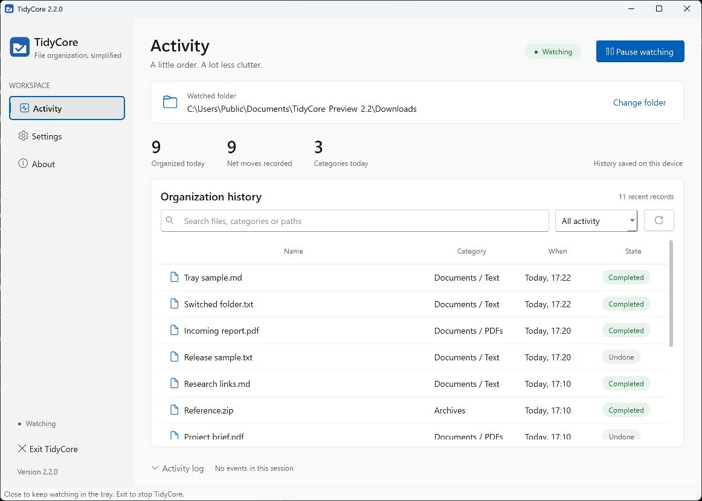
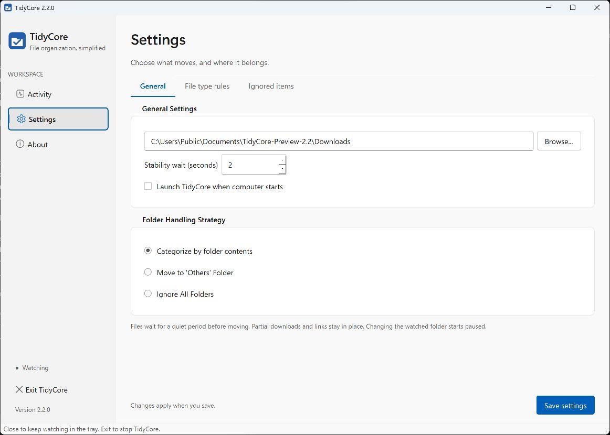

<div align="center">
  
  <h1>TidyCore</h1>
  <p>A place for every file.</p>
  <p>A native Windows file organizer with a Fluent-inspired workspace,<br>clear rules, persistent history and moves you can undo.</p>

  [Download for Windows](https://github.com/hei1sme/tidycore/releases/latest) · [Release notes](https://github.com/hei1sme/tidycore/releases/tag/v2.2.1) · [Report an issue](https://github.com/hei1sme/tidycore/issues)
</div>



## Your folders, with a little more order

Choose a folder and TidyCore watches for new arrivals. Documents, images, archives
and other files move into categories you control. Everything happens locally,
with a record of what moved and where it went.

- **A Windows-first workspace.** Fluent-inspired navigation, system glyphs,
  readable state badges and a focused activity view, built with native Qt Widgets.
- **History you can search.** Find files by name, category or path; filter organized,
  undone and attention-needed operations. History survives restarts.
- **Rules that fit your files.** Flat or nested categories, ignored names/extensions,
  a configurable stability wait, and optional folder-content categorization.
- **Moves with safeguards.** Partial downloads wait, locked files retry, collisions
  receive a numbered name, and symbolic links/junctions stay out of the organizer.
- **Undo with checks.** Restore unchanged contents to an empty original path.
  Restored paths stay excluded so the watcher does not immediately sort them again.
- **Quiet background operation.** Close to the Windows tray, reopen from the icon
  or launch the EXE again, and explicitly Exit when you want watching to stop.

## Get started

1. Download **TidyCore-v2.2.1-Windows.zip** from [Releases](https://github.com/hei1sme/tidycore/releases/latest).
2. Extract it and run **TidyCore.exe**. No Python installation is needed.
3. Open **Settings → General**, choose a folder, review the rules and save.
4. Return to **Activity** and select **Start watching**.

First launch is **paused with no folder selected**. Existing files in the selected
folder are included after the stability wait. Folders are ignored by default;
opt into content-based categorization or moving folders to Others when wanted.
Keep the EXE outside the folder you intend to organize.

If an update is downloaded into your saved watched folder, v2.2.1 opens Settings
with watching paused and the target temporarily cleared. Move the app outside
that folder, select the folder again and save. The original settings file and
history are retained until you explicitly save settings.

The executable is unsigned. Checksums are included with the release. Updates are
manual downloads; TidyCore does not silently check, download or replace itself.

## Make it yours



Settings is divided into **General**, **File type rules** and **Ignored items**.
The Save action stays visible while you work. Changing the watched folder starts
the new target paused, so you can review it before organization begins.

| Shortcut | Action |
|---|---|
| Ctrl+F | Search history |
| Ctrl+P | Pause or resume watching |
| Ctrl+Z | Undo the selected move |
| Alt+V | Save settings |

The Activity log expands for session messages and opens automatically on errors.
The history view displays the latest 200 persisted operations. Summary numbers
are completed journal operations minus undo, not a live inventory of files on
disk; a folder move counts as one operation. External file deletion/moves do not
rewrite the journal.

## Local data and recovery

Settings, rotating logs and `tidycore_stats.db` live in **`%LOCALAPPDATA%\TidyCore`**,
independently of the executable or working directory. A configuration save is
atomic and keeps the previous settings file as `config.json.bak`.

SQLite records a pending operation before a move and completion afterward. On
restart, interrupted operations are reconciled against paths and content hashes;
ambiguous cases are left for manual review. Schema upgrades create a consistent
backup first. Corrupt or newer databases are retained and startup stops visibly.

See [recovery guidance](docs/RECOVERY.md) before importing older state or restoring
a backup. v2.0.1 data stored beside an executable/source checkout is not imported
automatically. Review old targets and set `start_paused` to `true` before importing.
Legacy operations without fingerprints cannot safely offer automatic undo.

## Develop on Windows

Python **3.12.10**, **PySide6 6.9.1**, watchdog and SQLite. Use a project-local
Windows environment from PowerShell:

```powershell
py -3.12 -m venv .venv
& .\.venv\Scripts\python.exe -m pip install -r requirements-dev.txt
& .\.venv\Scripts\python.exe -m pytest -q
& .\.venv\Scripts\python.exe -m pip check
```

Use disposable inputs for development. Create an isolated data directory with a
`watch` subfolder, then launch:

```powershell
& .\.venv\Scripts\python.exe main.py --data-dir C:\TidyCore-Test --test-mode
```

Test mode confines watched folders to that data directory and disables Windows
startup integration. Select its disposable `watch` subfolder in Settings. Do not
use Downloads, synced folders or other personal data for tests.

Build the portable EXE and ZIP:

```powershell
& .\.venv\Scripts\python.exe scripts/build_release.py
```

Builds use unique output directories, include Windows file-version metadata,
and produce `BUILD.json` and `SHA256SUMS.txt`. They do not kill processes or delete
previous builds. The GitHub workflow runs isolated Windows tests on main/PRs;
a manual workflow run also builds an artifact. Publishing remains a separate action.

## Scope and limits

TidyCore is validated as a **Windows desktop application**. It uses same-volume
Windows rename without a copy/delete fallback. A quiet-period check is a heuristic:
another application can still write later. Changed contents, occupied originals
and missing destinations require manual handling rather than a forced undo.
Persistent undo exclusions currently have no reset control in the UI.

Other operating systems, network shares, cloud sync, alternate data streams,
hostile path replacement, large-directory performance and physical power-loss
durability are not validated. Automatic backups occur before schema upgrades,
not on a schedule. See the [validation record](docs/VALIDATION.md) and
[assessment](docs/ASSESSMENT.md) for evidence and boundaries.

## Project

[Design](DESIGN.md) · [Structure](docs/PROJECT_STRUCTURE.md) · [Build workflow](docs/RELEASE_WORKFLOW.md) · [Changelog](docs/CHANGELOG.md)

Created by **Le Nguyen Gia Hung (hei)**. Licensed under the [MIT License](LICENSE).
